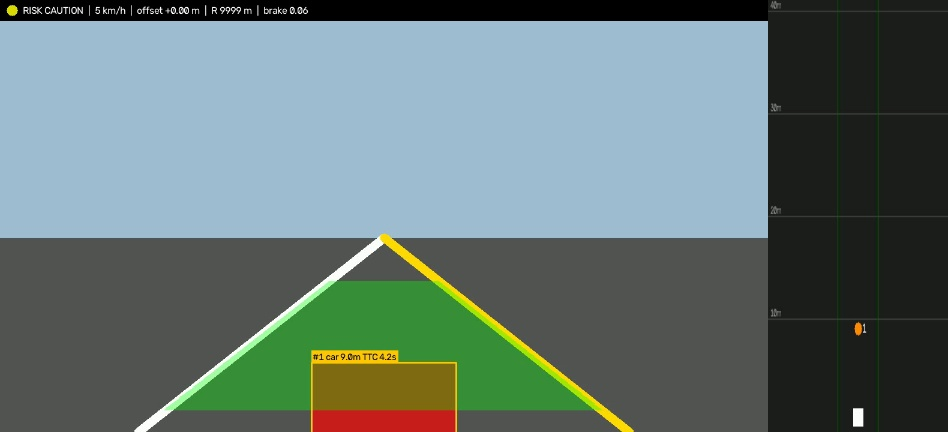

# Autonomous Driving Perception Stack

[](https://github.com/<you>/adpstack/actions)

A vision pipeline that **detects** vehicles / pedestrians / cyclists / traffic lights, **tracks** them (ByteTrack),
finds **lanes** two ways (classical OpenCV vs a U-Net segmentation model), estimates **distance** (MiDaS + pinhole fusion),
computes **time-to-collision and risk**, and **brakes** (AEB + ACC + lane keeping) inside **CARLA** through **ROS2** nodes.
Models are exported to **ONNX** and optimized with **TensorRT** with before/after benchmarks; all experiments log to **Weights & Biases**.


*Model-free synthetic preview (`scripts/synthetic_demo.py`): real lane detection, tracking, distance/TTC, risk and BEV. The CARLA demo video is recorded on the GPU VM.*

## Status (honest)
| Component | State |
|---|---|
| Data conversion, EDA, tracker, MOT metrics, classical lanes, depth calibration, distance/TTC/risk, controller, YOLO ONNX decoder, pipeline | Implemented and **unit-tested (30 tests, CPU)** |
| YOLO training, U-Net training, TensorRT, benchmarks | Implemented; **must be run on a GPU** (notebooks provided) |
| ROS2 nodes + CARLA bridge + scenarios + metrics | Implemented; **run on the Ubuntu 22.04 GPU VM** (not testable on Windows/AMD iGPU) |
| Result tables | Filled from real runs in `docs/results.md` (TODO rows = not yet run) |

## Quickstart (laptop, CPU)
```bash
pip install -e ".[dev]" && pytest
python scripts/closed_loop_sim.py          # AEB logic check
python scripts/synthetic_demo.py           # preview video
adp run --source drive.mp4 --weights best.onnx --out outputs/demo.mp4   # after training
```
Full instructions for Colab and the CARLA VM: [`docs/setup.md`](docs/setup.md).

## Repository map
```
configs/        YAML configs (yolo, tracker, lane, depth, control, carla)
src/adpstack/   data | detection | tracking | lane | depth | fusion | control | export | viz | pipeline | cli
ros2_ws/src/    adp_msgs | adp_carla_bridge | adp_perception | adp_control | adp_bringup
notebooks/      01_eda | 02_yolo_train_colab | 03_tensorrt_colab
scripts/        closed_loop_sim.py, synthetic_demo.py, run_scenarios.sh
docker/         Dockerfile.ros2, Dockerfile.train, docker-compose.yml
docs/           architecture.md, api.md, setup.md, results.md
tests/          CPU-only pytest suite
```

## Reproduce the pipeline end to end
1. `docs/setup.md` section 2: download BDD100K 10K, convert, run EDA.
2. Colab: `02_yolo_train_colab.ipynb` (YOLO11n + YOLOv8s ablation), U-Net training, evaluation.
3. Colab: `03_tensorrt_colab.ipynb` -> latency/FPS table (PyTorch vs ONNX Runtime vs TensorRT FP16/INT8).
4. VM: calibrate MiDaS against CARLA depth, run `scripts/run_scenarios.sh`, record the demo.
5. Copy numbers into `docs/results.md`, link the W&B report here: **W&B report: TODO**.

## Limitations and next steps
Monocular scale ambiguity, domain gap BDD100K -> CARLA, no planner/map, single camera. Next: LiDAR/radar fusion,
learned depth with metric head, ReID tracker comparison (DeepSORT), Jetson Orin deployment, closed-loop RL tuning.

## License
MIT
