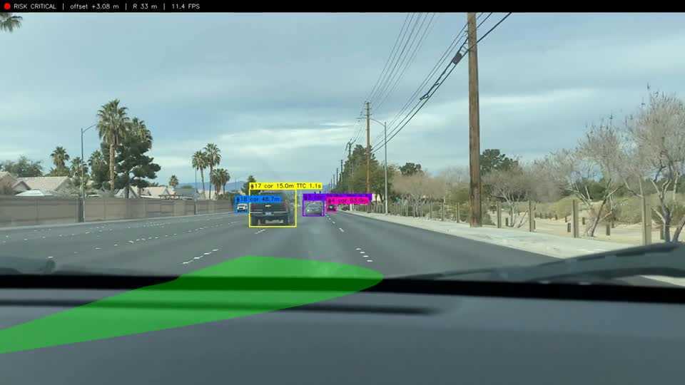
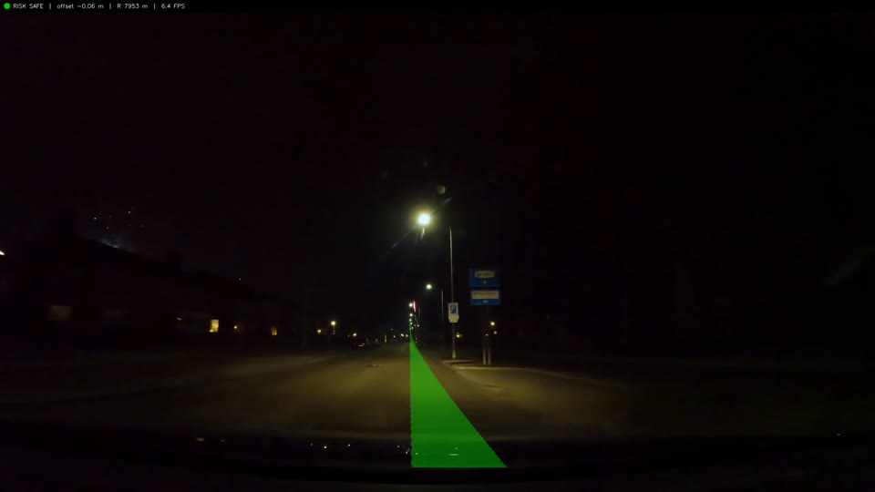
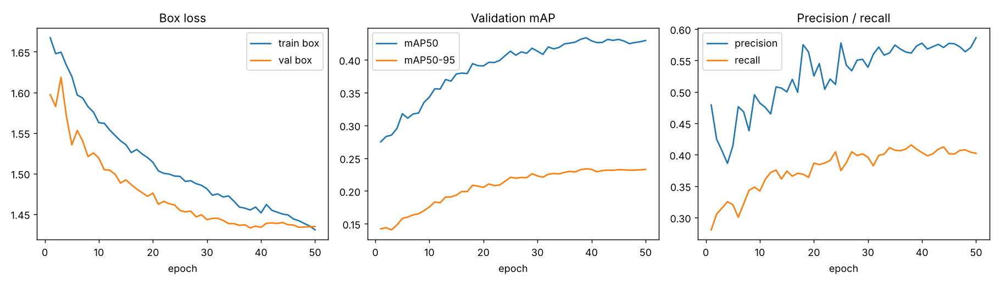
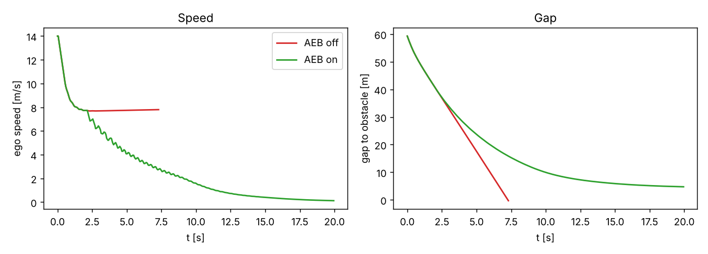

# Autonomous Driving Perception Stack

This repository is a research prototype for an autonomous-driving perception stack. It includes a BDD100K data-preparation workflow, YOLO11n object detection, ByteTrack tracking, classical lane detection, monocular depth and distance/TTC/risk fusion, control components, and ONNX/TensorRT benchmarking. The repository also contains CARLA and ROS2 integration code, but those components have not been run together.

**Live results page:** [30nikamvaishnavi.github.io/autonomous-driving-perception-stack](https://30nikamvaishnavi.github.io/autonomous-driving-perception-stack/)

## Status

| Component | Status |
|---|---|
| BDD100K subset preparation and EDA | Done; 10,000 training and 2,000 validation images |
| YOLO11n training | Done; 50 epochs on a Kaggle Tesla T4 |
| TensorRT FP16/INT8 benchmark | Done on a Kaggle Tesla T4 |
| Real-video pipeline | Runs as a qualitative demo; shown lane and risk outputs include failures |
| ByteTrack | Partial; code and unit tests, no tracking accuracy numbers |
| Classical lane detection | Partial; runs on real video, no accuracy numbers, failures shown below |
| U-Net lane model | Not done |
| MiDaS distance error evaluation | Not done |
| CARLA + ROS2 | Code written, not run |
| W&B online tracking | Partial; online tracking was not completed because authentication failed on a hosted W&B instance |
| Obstacle-reaction demo video | Not done |

## Screenshots

These are qualitative examples, including failure cases; they are not accuracy evidence.

### Daytime frame



Detection and tracking IDs are shown, with distance and TTC from the uncalibrated pinhole prior. The lane overlay is wrong and covers the dashboard; the CRITICAL risk label is a false alarm. Shown as a failure case.

### Night frame



Night clip: the lane overlay does not follow a visible lane, and there are no detections in this frame.

### Training curves



YOLO11n 50-epoch curves from [results.csv](docs/figures/results.csv).

### Kinematic braking simulation



Kinematic braking simulation, not CARLA.

## Architecture

See [docs/architecture.md](docs/architecture.md) for the system diagrams and data flow.

## Features

- Prepare a reproducible BDD100K detection subset and run dataset EDA.
- Train and run YOLO11n object detection; export/benchmark ONNX and TensorRT backends.
- Track detections with ByteTrack and compute tracking metrics.
- Detect lanes with a classical OpenCV pipeline.
- Estimate distance using MiDaS or a pinhole/class-height prior; combine distance, TTC, and risk.
- Run AEB/ACC control logic and a kinematic braking simulation.
- Use the video pipeline to render detections, tracks, lane overlays, and a HUD.
- Find CARLA bridge and ROS2 perception/control integration code in `ros2_ws/`; this integration has not been run.

## Quickstart (without a GPU)

On Windows PowerShell, from the repository root:

```powershell
py -3.11 -m venv .venv
.\.venv\Scripts\Activate.ps1
python -m pip install -e ".[dev]"
python -m pytest
python scripts/closed_loop_sim.py
python scripts/synthetic_demo.py
```

The test suite and kinematic simulation run without a GPU. The synthetic demo writes a model-free preview video to `outputs/synthetic_demo.mp4`.

## Run on GPU

[](https://colab.research.google.com/github/30nikamvaishnavi/autonomous-driving-perception-stack/blob/main/notebooks/00_gpu_smoke_test.ipynb)

- [YOLO training notebook](notebooks/04_kaggle_yolo_train.ipynb) — Kaggle GPU; requires the private `bdd100k-adpstack-subset` dataset.
- [TensorRT benchmark notebook](notebooks/05_tensorrt_kaggle.ipynb) — Kaggle Tesla T4; requires trained weights and the YOLO dataset configuration.
- [Pipeline video notebook](notebooks/06_pipeline_video_kaggle.ipynb) — Kaggle GPU; requires trained weights and a short video clip.

## Data

BDD100K is not included in this repository. Use [`scripts/make_bdd_subset.py`](scripts/make_bdd_subset.py) to create the training subset from a local BDD100K dataset. Users must obtain BDD100K and accept its license terms before downloading or using it.

```powershell
python scripts/make_bdd_subset.py --source data/bdd100k --out data/bdd100k-adpstack-subset
```

The documented input layout is `data/bdd100k/images/{train,val}` and `data/bdd100k/labels/det_20/det_{train,val}.json`.

## Results

### YOLO11n training

Measured on a Kaggle Tesla T4 over 50 epochs. The run took 4,571.65 seconds (about 76 minutes). The highest validation mAP50-95 in `results.csv` was at epoch 39; epoch 50 is the last epoch. Training loss kept falling while validation mAP stayed roughly flat after about epoch 39, a possible sign of overfitting (a hypothesis, not proven).

| Epoch | mAP50 | mAP50-95 |
|---:|---:|---:|
| 39 (best validation mAP50-95) | 0.43376 | 0.23392 |
| 50 (last) | 0.42950 | 0.23294 |

The separate `best.pt` evaluation in [`docs/figures/detection_eval.json`](docs/figures/detection_eval.json) reports mAP50 **0.43375**, mAP50-95 **0.23445**, precision **0.56860**, and recall **0.40862**.

### Detection dataset

BDD100K subset box counts measured for the 10,000-image training and 2,000-image validation sets:

| Class | Train boxes | Validation boxes |
|---|---:|---:|
| Car | 103,386 | 20,375 |
| Traffic sign | 34,587 | 6,989 |
| Traffic light | 26,942 | 5,466 |
| Person | 13,574 | 2,500 |
| Truck | 4,100 | 866 |
| Bus | 1,595 | 311 |
| Bicycle | 1,012 | 178 |
| Rider | 627 | 136 |
| Motorcycle | 427 | 100 |

### `best.pt` detection evaluation

Measured on 2,000 validation images. The same validation set was used for checkpoint selection and evaluation.

| Class | AP50-95 |
|---|---:|
| Car | 0.415 |
| Truck | 0.369 |
| Bus | 0.341 |
| Motorcycle | 0.109 |
| Bicycle | 0.142 |
| Person | 0.208 |
| Rider | 0.117 |
| Traffic light | 0.163 |
| Traffic sign | 0.247 |

### ONNX / TensorRT benchmark

Measured on a Kaggle Tesla T4 with TensorRT 11.5.0.63 and Ultralytics 8.4.215. Latency is end-to-end `predict()` for a 1280x720 image, batch 1, 300 iterations after 30 warm-up iterations.

| Backend | Mean ms | p50 ms | p95 ms | p99 ms | FPS | Speed-up | mAP50 | mAP50-95 |
|---|---:|---:|---:|---:|---:|---:|---:|---:|
| PyTorch FP32 (CUDA) | 9.96 | 9.85 | 10.44 | 11.41 | 100.4 | 1.00x | 0.434 | 0.234 |
| TensorRT FP16 | 4.32 | 4.17 | 4.88 | 5.68 | 231.6 | 2.31x | 0.433 | 0.232 |
| TensorRT INT8 | 4.42 | 4.19 | 5.85 | 5.92 | 226.0 | 2.25x | 0.414 | 0.221 |

### Real-video pipeline timing

Measured on a Kaggle Tesla T4 with YOLO11n `best.pt`, `--no-depth`, and at most 300 frames per clip. Values are median per-stage latency in milliseconds; video decoding and drawing are excluded.

| Pexels video | Input size | Frames | Detect ms | Track ms | Lane ms | Fusion ms |
|---|---:|---:|---:|---:|---:|---:|
| 3602494 | 1920x1080 | 300 | 12.7 | 0.8 | 74.1 | 0.48 |
| 3978374 | 1920x1080 | 213 | 12.7 | 0.7 | 78.4 | 0.31 |
| 14966361 | 2560x1440 output | 300 | 12.9 | 0.5 | 135.6 | 0.05 |
| 4608285 | 3840x2160 | 300 | 13.5 | 0.9 | 258.4 | 0.46 |
| 5921059 | 3840x2160 | 300 | 13.5 | 1.3 | 255.9 | 0.34 |

### Kinematic closed-loop simulation

The simulation is not CARLA and does not measure perception accuracy.

| Scenario | Result |
|---|---|
| Stationary obstacle at 60 m; ego speed 14 m/s; 20 noisy runs | Without AEB: 100% collisions, 7.8 m/s mean impact. With AEB: 0% collisions, 4.7 m minimum gap. |
| Slow lead vehicle at 5 m/s, initially 45 m ahead | Without AEB: 100% collisions, 7.9 m/s impact. With AEB: 0% collisions, 10.3 m minimum gap. |

### Mapping to the internship brief

| Step | Deliverable | Status |
|---|---|---|
| 1 | BDD100K subset and label preparation | Done |
| 2 | YOLO11n fine-tuning and ByteTrack tracking | YOLO11n: Done. ByteTrack: Partial; code and unit tests, no accuracy numbers. |
| 3 | Classical and U-Net lane detection | Classical: Partial; runs on real video, no accuracy numbers, fails on the shown clips. U-Net: Not done. |
| 4 | MiDaS distance evaluation | Not done; distance error is not measured. |
| 5 | CARLA + ROS2 | Code written, not run. |
| 6 | ONNX/TensorRT benchmark | Done; measured Kaggle Tesla T4 benchmark above. |
| 7 | W&B tracking and obstacle-reaction demo | W&B: Partial; online tracking was not completed due to authentication error on a hosted W&B instance. Obstacle-reaction demo video: Not done; a real-video pipeline demo and synthetic braking simulation exist. |

Online W&B tracking was not completed because authentication failed on a hosted W&B instance. Training metrics are available in [`docs/figures/results.csv`](docs/figures/results.csv) and [`docs/figures/training_curves.png`](docs/figures/training_curves.png). No online W&B run is claimed.

## Limitations

- The real-video distance values use a pinhole prior and camera intrinsics configured for 1280x720; they are illustrative and uncalibrated.
- The screenshots show lane-detection and risk-label failures; tracking, lane, and distance accuracy on the clips is not measured.
- The validation images used for checkpoint selection are also used for evaluation, so detection metrics may be optimistic.
- INT8 calibration used 300 images from the same validation pool used for evaluation.
- The TensorRT INT8 run was not faster than FP16 and had lower mAP50 than FP32.
- CARLA and ROS2 were not run together. The kinematic simulation does not establish CARLA or real-world behavior.
- The controller is a research prototype, not a safety system.

## Credits

The following Pexels videos were used only to demonstrate the perception pipeline:

- [Video 3602494](https://www.pexels.com/video/footage-of-a-vehicle-traveling-in-the-road-3602494/) by Sher Lyn.
- [Video 3978374](https://www.pexels.com/video/motor-vehicles-driving-on-the-road-3978374/) by K.
- [Video 14966361](https://www.pexels.com/video/driving-on-the-street-on-new-year-s-eve-14966361/) by Matthias Groeneveld.
- [Video 4608285](https://www.pexels.com/video/vehicle-on-highway-with-dash-cam-4608285/) by K.
- [Video 5921059](https://www.pexels.com/video/dash-cam-view-of-the-road-5921059/) by Aleks Magnusson.

## License

MIT
