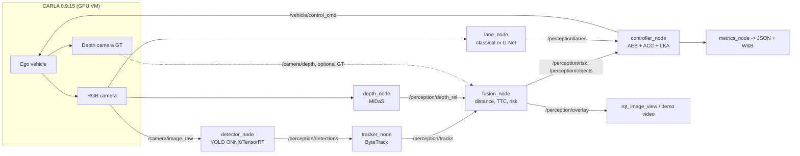
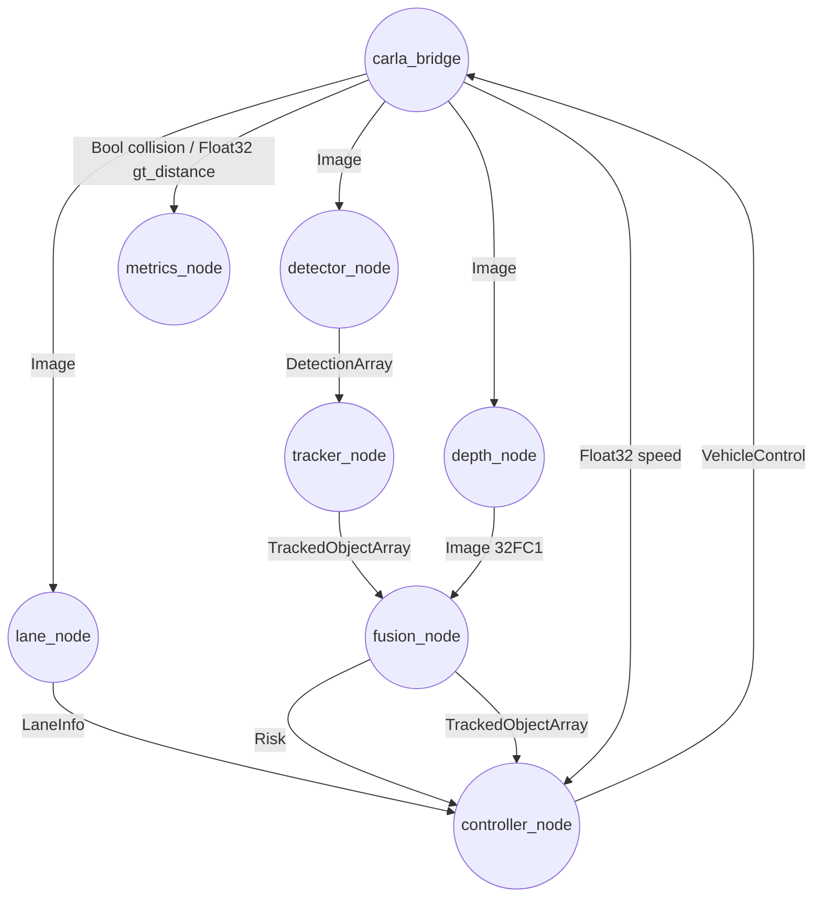
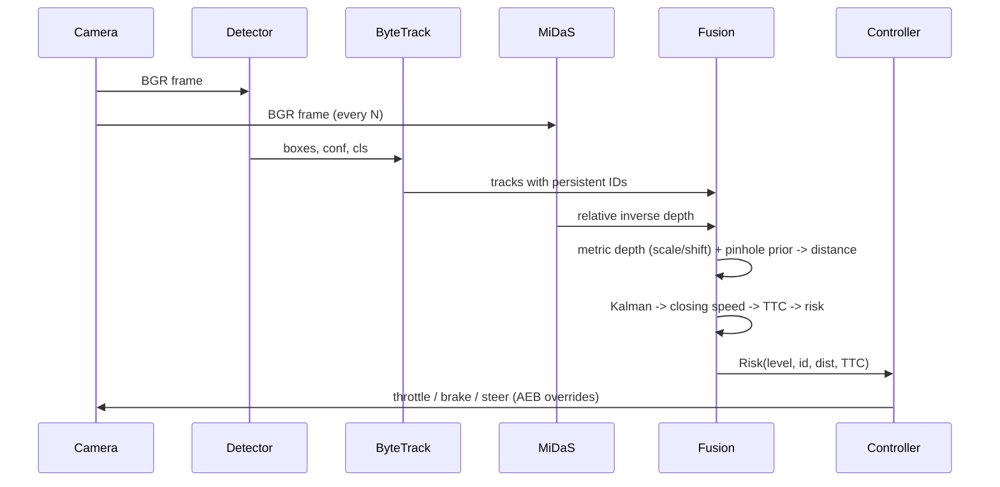
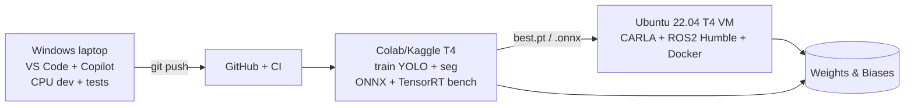

# Architecture

## System overview

## ROS2 graph (topics)

## Per-frame data flow

## Deployment

## Design decisions
- **Backend-agnostic detector** (`Detector`): same code path for `.pt`, `.onnx` (CPU / DirectML / CUDA / TensorRT EP).
- **Own ByteTrack + MOT metrics** (numpy/scipy): unit-testable on CPU, no heavy dependencies.
- **Distance = fusion of two independent estimators** (MiDaS calibrated by least squares vs. CARLA depth; pinhole + class height prior).
- **TTC from a Kalman-filtered distance**, never from raw frame-to-frame differences (noise).
- **AEB overrides ACC overrides cruise**; lane keeping uses the Stanley law on the lane offset.
- **Everything is configured in `configs/*.yaml`** with dotted overrides (`--set epochs=5`).
